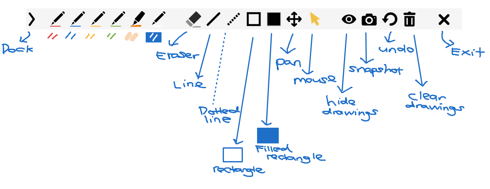
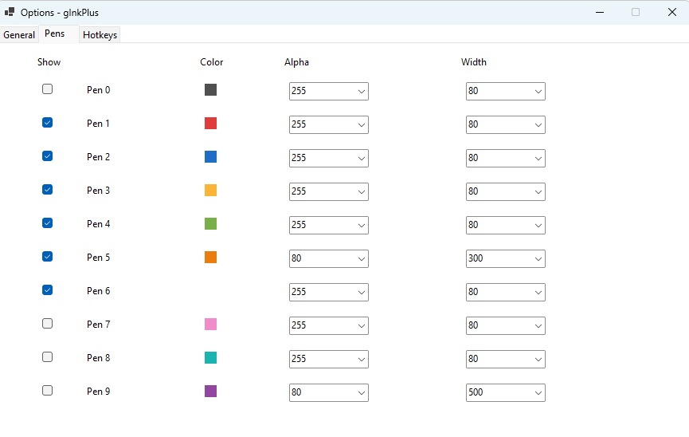
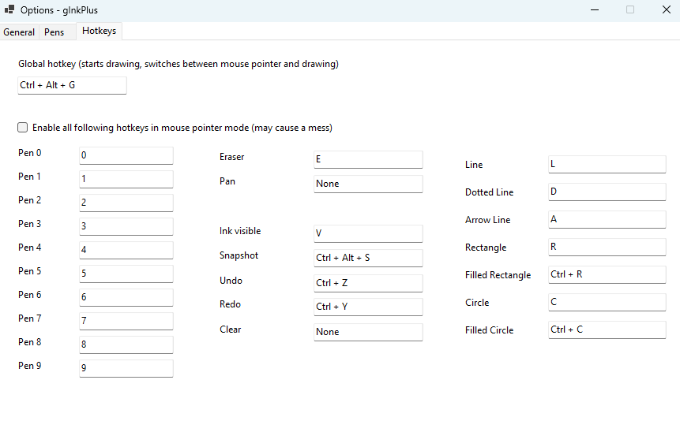

# gInkPlus

A simple, lightweight on-screen annotation tool for Windows. gInkPlus is a screen annotation tool based on the original gInk.

## Introduction

gInk is an on-screen annotation tool for Windows, designed for presentations, demonstrations, and quick note-taking directly over your display.

Inspired by existing commercial annotation utilities, gInk prioritizes a clean, unobtrusive interface that keeps the focus on your content without distracting presenters or audiences.

Rather than forcing you to constantly tweak color, transparency, and stroke width on the fly, gInk lets you switch instantly between customizable pen presets—each pre-configured with your preferred settings.

gInkPlus builds on the original gInk by adding essential shape and line tools—including solid lines, dotted lines, outlined rectangles, and filled rectangles—while preserving its lightweight, intuitive interface, with more tools planned for future updates.

## Download

gInk
https://github.com/geovens/gInk/releases/

gInkPlus
https://github.com/mwtoolz/gInkPlus/releases/

## How to use

Start: Launch gInkPlus to add its icon to the system tray.

Draw: Click the tray icon (or press your hotkey) to begin annotating your screen.

Exit: Click the exit button or press Esc to return to normal desktop control.

Configure: Right-click the tray icon and open Options to customize pens and hotkeys.

## Graphics Tablet Configuration

For the best drawing experience with gInkPlus, we recommend disabling **Windows Ink** in your graphics tablet's driver utility.

- **Windows Ink disabled:** Provides better shape-drawing behaviour without unwanted temporary stroke previews.
- **Windows Ink enabled:** Supports pen pressure sensitivity, but may cause unwanted temporary stroke previews when using geometric shape tools.

If pen pressure sensitivity is important to you, you may prefer to keep Windows Ink enabled and accept this limitation.

*Note: The availability and naming of this setting depend on your graphics tablet and its driver.*

## Features

**Original gInk features**
- Compact and intuitive interface.
- Ink rendering on dynamic desktops.
- Stylus with eraser, touchscreen and mouse compatibility.
- Click-through mode.
- Multiple display support.
- Pen pressure support.
- Snapshot support.
- Hotkey support.

**Additional gInkPlus tools**
- Line tool.
- Dotted Line tool.
- Arrow Line tool.
- Outline rectangle tool.
- Filled rectangle tool.

## Tips
-  gInkPlus introduces additional drawing tools while retaining the simple interface of the original gInk project. More tools may be considered in future versions.
- There are a few hidden options you can tweak in config.ini that are not shown in the options window.
- If you need a more feature-rich annotation tool with additional capabilities, you may also want to explore ppInk (https://github.com/pubpub-zz/ppInk), another project based on gInk that offers a wider range of annotation features.

----
gInk
https://github.com/geovens/gInk
Original project by Weizhi Nai

gInkPlus
https://github.com/mwtoolz/gInkPlus
Maintained by mwtoolz

