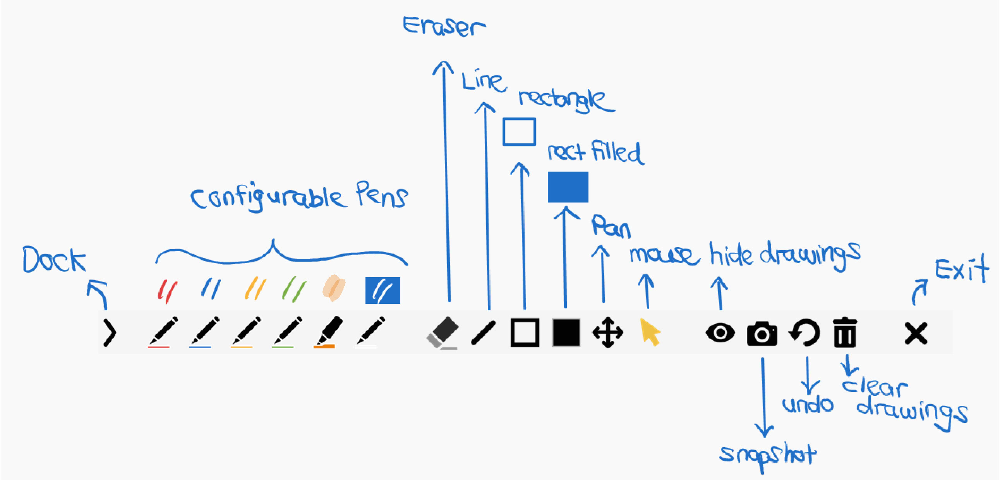

# gInkPlus

A simple, lightweight on-screen annotation tool for Windows. gInkPlus is a screen annotation tool based on the original gInk.

## Introduction

gInk is an on-screen annotation software for Windows, designed to help with presentations, demonstrations and making quick notes directly on the screen.

Its features are greatly inspired by another screen annotation software, Epic Pen, while maintaining a simple and intuitive interface. The idea behind gInk is to keep the interface as unobtrusive as possible so that it does not distract the presenter or audience during presentations.

Unlike many other annotation tools, gInk allows users to select from a set of configurable pens rather than repeatedly adjusting individual settings such as colour, transparency and stroke width. Each pen is a combination of these attributes and can be customised to suit your needs.

gInkPlus builds on the original gInk with additional drawing tools while keeping the interface simple. These include a line tool, an outline rectangle tool and a filled rectangle tool.

## Download

gInk
https://github.com/geovens/gInk/releases/

gInkPlus
https://github.com/mwtoolz/gInkPlus/releases/

## How to use

Start gInkPlus and an icon will appear in the system tray. Click the icon (or use a hotkey) to start drawing on screen.
Click the exit button or press ESC to exit drawing.

## Graphics Tablet Configuration

For the best drawing experience with gInkPlus, we recommend disabling **Windows Ink** in your graphics tablet's driver utility.

- **Windows Ink disabled:** Provides better shape-drawing behaviour without unwanted temporary stroke previews.
- **Windows Ink enabled:** Supports pen pressure sensitivity, but may cause unwanted temporary stroke previews when using geometric shape tools.

If pen pressure sensitivity is important to you, you may prefer to keep Windows Ink enabled and accept this limitation.

*Note: The availability and naming of this setting depend on your graphics tablet and its driver.*

## Features

**Original gInk features**
- Compact and intuitive interface.
- Ink rendering on dynamic desktops.
- Stylus with eraser, touchscreen and mouse compatibility.
- Click-through mode.
- Multiple display support.
- Pen pressure support.
- Snapshot support.
- Hotkey support.

**Additional gInkPlus tools**
- Line tool.
- Outline rectangle tool.
- Filled rectangle tool.

## Tips
-  gInkPlus introduces additional drawing tools while retaining the simple interface of the original gInk project. More tools may be considered in future versions.
- There are a few hidden options you can tweak in config.ini that are not shown in the options window.
- If you need a more feature-rich annotation tool with additional capabilities, you may also want to explore ppInk (https://github.com/pubpub-zz/ppInk), another project based on gInk that offers a wider range of annotation features.

----
gInk
https://github.com/geovens/gInk
Original project by Weizhi Nai

gInkPlus
https://github.com/mwtoolz/gInkPlus
Maintained by mwtoolz

